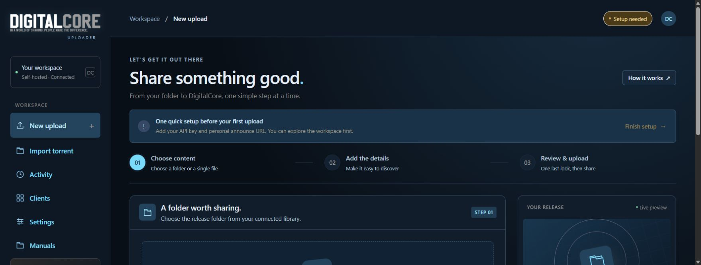
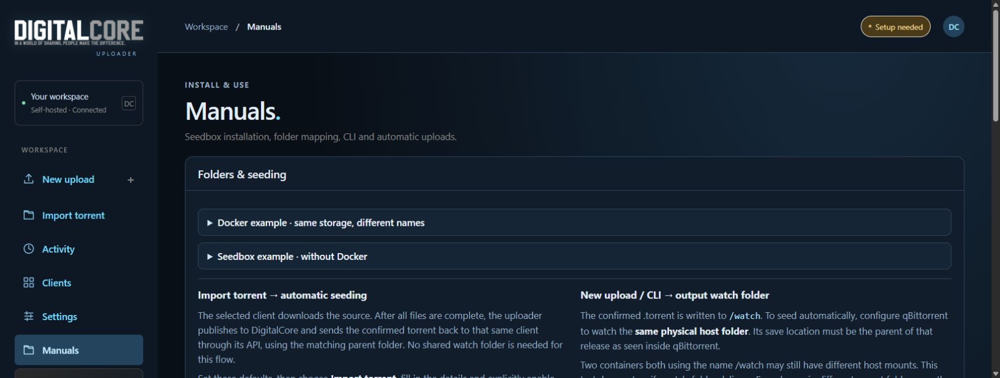
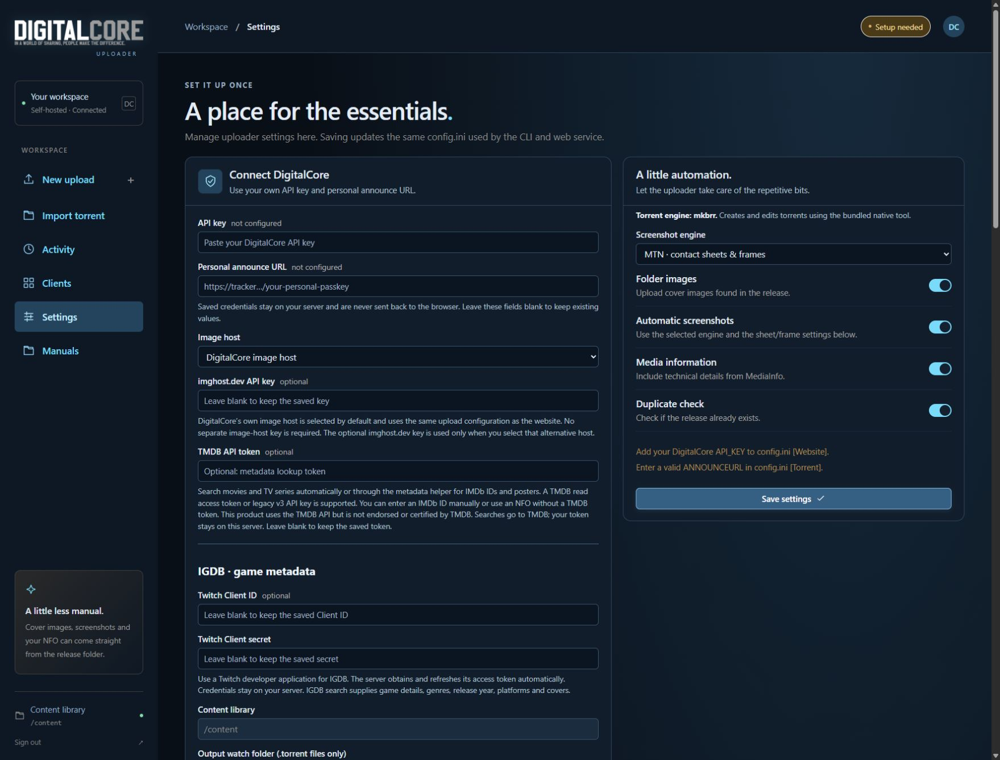
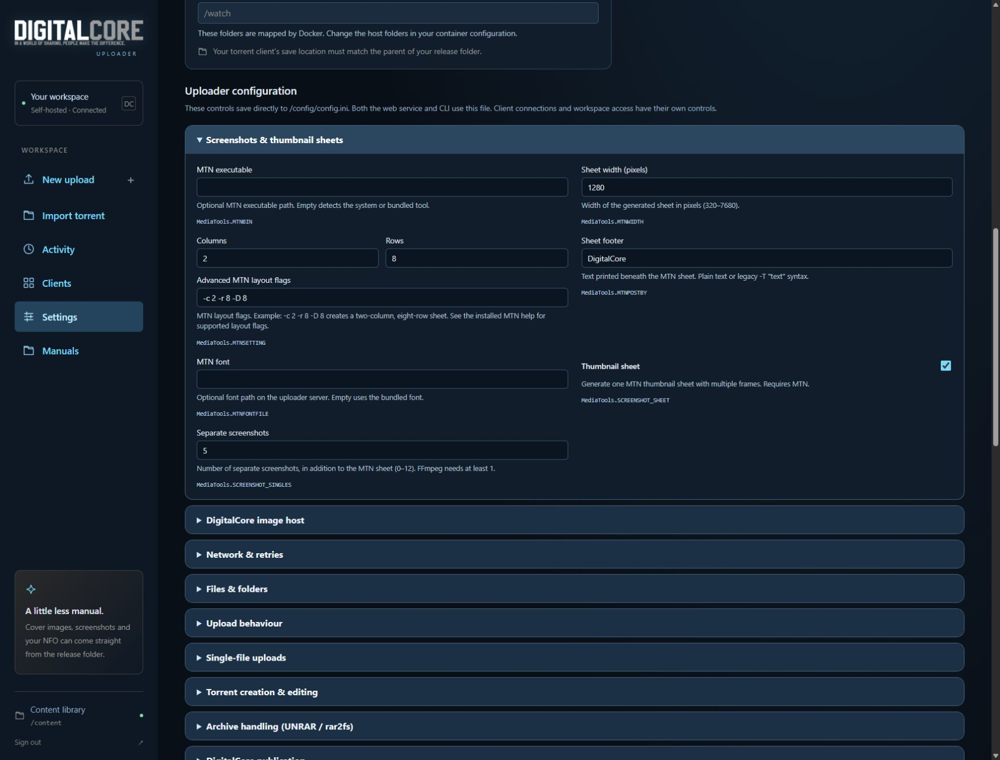
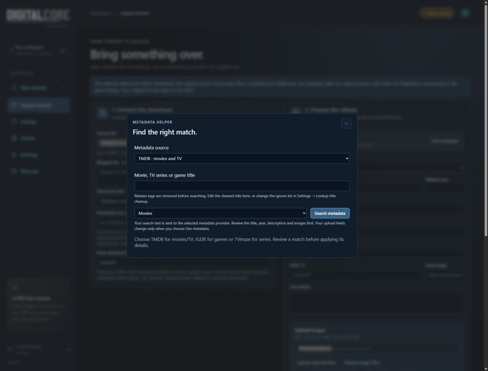

# DigitalCore Uploader

Upload to DigitalCore through your browser or the command line. Includes metadata
lookup with TMDB, TVmaze and IGDB, automatic screenshots, MediaInfo, DigitalCore's
image host and qBittorrent integration.

## Screenshots

The empty upload workspace:



Built-in installation and seeding guide:



### Settings & automation



### Screenshots & thumbnail sheets



In **Settings → Screenshots & thumbnail sheets → Videos to capture**, choose
**One video** (default) or **All videos (packs / site rips)**. All videos processes
every main video, including subfolders, with separate screenshot counts and an
optional MTN contact sheet for each video. Samples and extras are skipped when
main videos exist. Use the MTN engine for contact sheets; FFmpeg creates separate
screenshots only. These settings apply to browser uploads, imports and CLI uploads.

For CLI configuration:

```ini
[MediaTools]
SCREENSHOT_VIDEO_MODE = all
SCREENSHOT_ENGINE = mtn
SCREENSHOT_SHEET = true
SCREENSHOT_SINGLES = 3
```

This creates one sheet and three separate screenshots per video. With required
screenshots enabled, a failed video stops publication; disabling that option
allows partial previews and logs the failed videos.

### Metadata search



## Install

For Docker or Synology, you need Linux x86_64 and Docker Compose (Container Manager
on Synology).

```bash
git clone https://github.com/DigiCore404/digitalcore-uploader.git
cd digitalcore-uploader
docker build --target release -t digitalcore-uploader:local .
bash setup.sh --media /srv/media --image digitalcore-uploader:local --bind 0.0.0.0
```

Replace `/srv/media` with your media folder. When running as root, also pass your
normal account's `--uid` and `--gid`.

Open `http://<server-ip>:6080` and sign in with the login shown during installation.

[Docker and Synology setup](README-docker.md) · [Linux seedbox setup](SEEDBOX-INSTALL.md)

## Upload

1. Add your DigitalCore API key and personal announce URL in **Settings**.
2. Connect qBittorrent in **Clients** if you want to import torrents.
3. Choose **New upload** or **Import torrent**, fill in the release details and review before uploading.

DigitalCore's image host is ready to use. TVmaze works without a key; TMDB and
IGDB can be enabled in Settings with your own credentials.

Keep seeding after uploading. Folder and seeding instructions are available in
**Manuals** inside the uploader.

## Command line

The CLI, download-completion callback and folder watcher remain available.
For a native Linux installation, upload a release with:

```bash
bash start.sh upload /srv/media/My.Release --cat 6
```

Browser and CLI uploads appear together in **Activity**, with their progress,
logs and results. Use the same installation and persistent data folder.

For a single file, select it in the content browser. The uploader creates a release
folder beside it and adds a link. Choose **Hardlink** or **Softlink** in
**Settings → Single-file uploads**. Hardlinks require the same filesystem;
softlinks require the original file to stay accessible. No file data is copied.
The seeding client must see both the release folder and original media through
the same library mapping. The media mount needs write access to create the folder.
