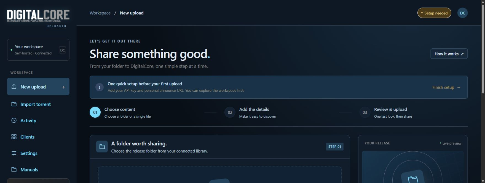
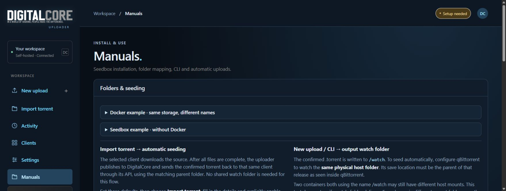
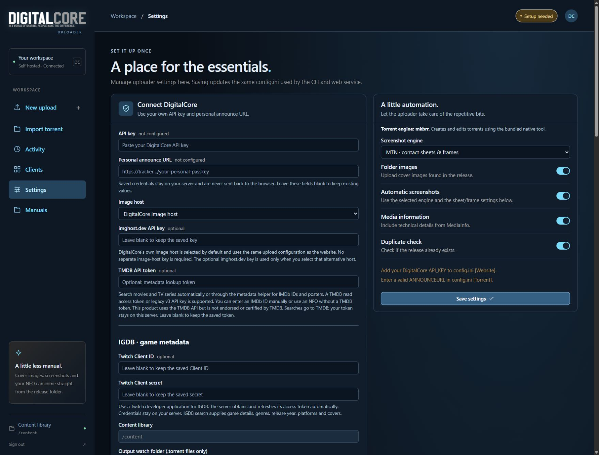
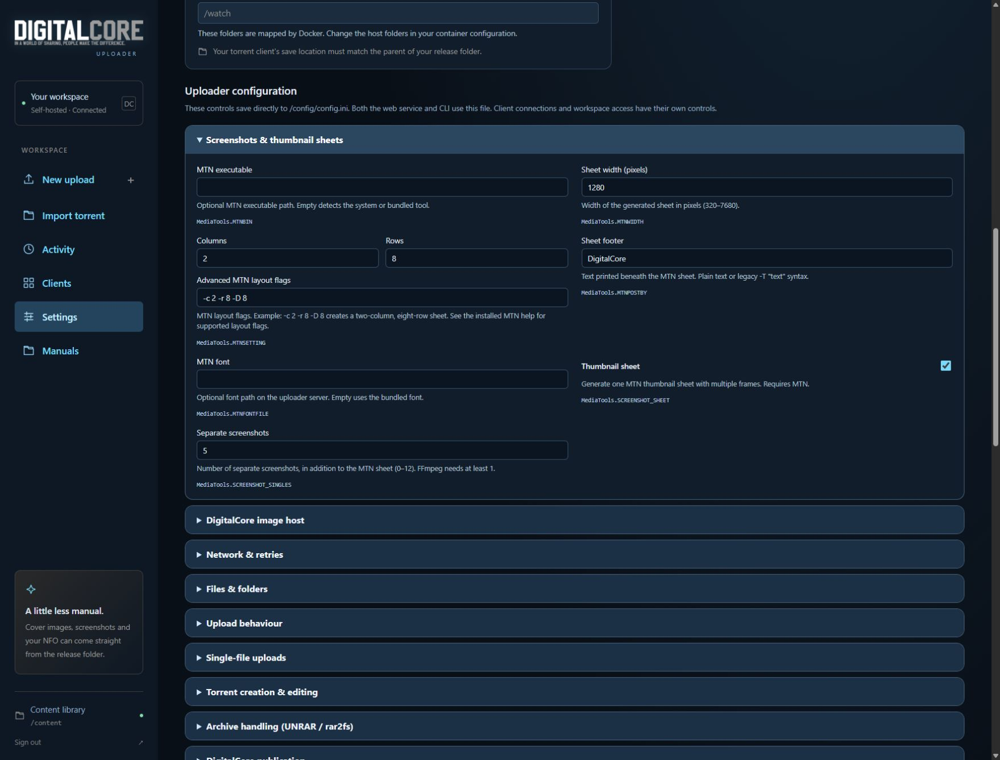
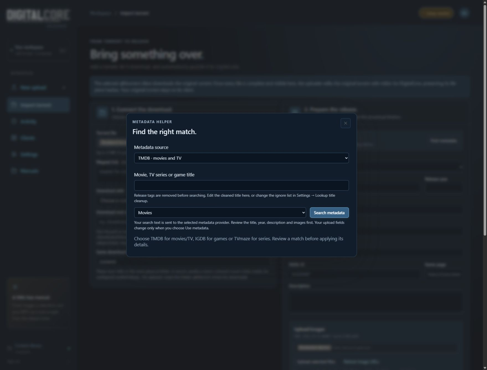

# DigitalCore Uploader

Upload to DigitalCore through your browser or the command line. Includes metadata
lookup with TMDB, TVmaze and IGDB, automatic screenshots, MediaInfo, DigitalCore's
image host and qBittorrent integration.

## Screenshots

The empty upload workspace:



Built-in installation and seeding guide:



### Settings & automation



### Screenshots & thumbnail sheets



In **Settings → Screenshots & thumbnail sheets → Videos to capture**, choose
**Automatic** (default: all videos for pack categories, one for other releases),
**One video**, or **All videos (packs / site rips)**. All videos processes
every main video, including subfolders, with separate screenshot counts and an
optional MTN contact sheet for each video. Samples and extras are skipped when
main videos exist. Use the MTN engine for contact sheets; FFmpeg creates separate
screenshots only. These settings apply to browser uploads, imports and CLI uploads.

For CLI configuration:

```ini
[MediaTools]
SCREENSHOT_VIDEO_MODE = auto
SCREENSHOT_ENGINE = mtn
SCREENSHOT_SHEET = true
SCREENSHOT_SINGLES = 3
SCREENSHOT_LIMIT = 0
```

Set **Maximum screenshots per release** to **5** or **10** to cap the total
across the release. The equivalent CLI setting is `SCREENSHOT_LIMIT = 5` (or
`10`); `0` means unlimited and keeps the existing behaviour. Each contact sheet
counts as one image. The final video's separate frame count is reduced to fit,
and later videos are skipped once the limit is reached. The upload continues.
This also applies to imports and local draft previews. Folder images, metadata
covers and manually entered image URLs are outside this limit.

For packs, this creates one sheet and three separate screenshots per video;
other release categories use one video. With required
screenshots enabled, a failed video stops publication; disabling that option
allows partial previews and logs the failed videos.

### Metadata search



## Install with Docker Compose

Requires Docker Compose v2 and an amd64 / x86_64 host. Create a directory for the
uploader and its persistent files:

```bash
mkdir -p digitalcore-uploader/workspace/{config,data,tmp,logs,watch,mounts}
cd digitalcore-uploader
```

Save this as `compose.yaml`. Replace `/srv/media` with your media folder and
`1000:1000` with your account's UID:GID (run `id` to find them). The workspace
directories must be writable by that account.

```yaml
services:
  uploader:
    image: ghcr.io/digicore404/digitalcore-uploader:latest
    init: true
    user: "1000:1000"
    shm_size: 256m
    restart: unless-stopped
    ports:
      - "6080:6080"
    environment:
      DIGITALCORE_CONFIG: /config/config.ini
      DIGITALCORE_WEB_PASSWORD: ${WORKSPACE_PASSWORD:?Set WORKSPACE_PASSWORD in .env}
    volumes:
      - /srv/media:/content
      - ./workspace/config:/config
      - ./workspace/data:/app/data
      - ./workspace/tmp:/app/tmp
      - ./workspace/logs:/app/logs
      - ./workspace/watch:/watch
      - ./workspace/mounts:/mounts
```

Create `.env` beside `compose.yaml`, choosing your own password of at least 12
characters. Use single quotes to keep special characters literal:

```dotenv
WORKSPACE_PASSWORD='replace-with-your-own-long-password'
```

Start the uploader:

```bash
docker compose up -d
```

Open `http://<server-ip>:6080` and sign in as `admin` with that password.
Configure your site credentials, upload preferences in **Settings**, and choose an **Settings → Image host** in its own panel.
Configuration and history stay in `workspace`. The password in `.env` initializes
the login only; change an existing login in **Settings → Workspace access**.

To update, from the same directory:

```bash
docker compose pull uploader
docker compose up -d --no-deps uploader
```

`latest` follows stable releases. Keep your existing workspace mounts when updating.
For CLI commands, use `docker compose run --rm uploader check` or
`docker compose run --rm uploader upload /content/My.Release --cat CATEGORY_ID`.
Use the appropriate category ID for your release.

## Install without Docker

Follow the [native Linux / seedbox installation guide](SEEDBOX-INSTALL.md) for
downloading, starting and updating the uploader.

Requires Python 3.10+, venv, FFmpeg/ffprobe and MediaInfo. Use Debian 12+ or Ubuntu 22.04+.

For RAR archive uploads without extracting first, you also need **FUSE 2
(`fuse` / `libfuse2`), rar2fs and UnRAR**. These are not installed by the default
native installation. The installer builds rar2fs and UnRAR with `--rar2fs`;
it needs a C++ compiler, make, autoconf, automake, libtool, pkg-config, curl,
CA certificates and FUSE development headers (`libfuse-dev`).

On your own Debian/Ubuntu server, run this from the unpacked installation directory:

```bash
bash install.sh --system-deps --rar2fs
```

On a managed seedbox, ask your provider to supply the system/build dependencies,
`/dev/fuse` access and permission to use `fusermount`, then run as your normal user:

```bash
bash install.sh --rar2fs
```

You do not need root to run the uploader; installing missing system packages or
enabling host FUSE requires your administrator/provider. Enable **Settings →
Archive handling (UNRAR / rar2fs)** after installation. Keep archive mounts active
and accessible to your torrent client for as long as you seed their unpacked files.
FUSE, rar2fs and UnRAR are only needed for the archive feature; ordinary media
uploads work without them. See [native installation details](SEEDBOX-INSTALL.md#optional-unrar--rar2fs).

## Library: browse and upload

Open **Library** to browse files and release folders on the uploader server.
**Add folder** saves a shortcut to a folder inside the configured content library;
it does not upload files from your PC. With Docker, mount additional media inside
`/content` in your Compose configuration. Without Docker, configure your server's
media root in **Settings → Folders & storage**. **Remove shortcut** only removes
the shortcut and leaves the media in place.

Each row shows the expected category from `filters.json`. Change the category
selector if the result is wrong. Configure and test the rules in **Settings →
Automatic categories · filters.json**: the first matching rule wins. Without a
matching rule, choose a category for that item or fix the rules before uploading.
Saved rules also apply to CLI uploads that use automatic category detection;
an explicit CLI `--cat` overrides automatic selection.

Right-click a release, or click its **…** button:

- **Upload Direct** starts immediately with the detected or corrected category.
  Metadata lookup, folder images, screenshots and contact sheets follow your
  saved settings. There is no separate metadata or review prompt.
- **Upload with metadata** opens a dialog to search for metadata or enter details,
  including tags/genres, language, description and image URLs.
  You can also correct the category. Entered details take precedence; blank fields
  use automatic detection. Click **Upload with metadata** to start.
- **Test category rules** checks the release name without uploading.
- **Open folder**, **Copy path** and **Refresh** help you browse the library.

Choose an individual release folder or file, not a parent containing unrelated
releases. Single files use the configured hardlink/softlink mode; browsing does
not create links. Follow progress and results in **Activity**. Seed the confirmed
torrent using your configured watch folder or client workflow.

For packs, **Settings → Screenshots & thumbnail sheets → Videos to capture →
Automatic** captures every main video in pack categories and one video in other
categories. **All videos** forces every main video; the screenshot count and
optional MTN contact sheet apply separately to each video.

## Upload

1. Add your DigitalCore API key and personal announce URL in **Settings**.
2. Connect qBittorrent in **Clients** for imports that need downloading; existing-data imports do not require a client.
3. Choose **New upload** or **Import torrent**, fill in the release details and review before uploading.

DigitalCore's image host is ready to use. TVmaze works without a key; TMDB and
IGDB can be enabled in Settings with your own credentials.

Keep seeding after uploading. Folder and seeding instructions are available in
**Manuals** inside the uploader.

## Reuse an existing torrent

Already have the complete pack or site rip? In **Import torrent**, enable
**Data already exists: reuse existing torrent**. Choose its original `.torrent`
(up to 64 MB), browse to the matching local release folder or file, fill in the
release details and click **Upload existing data**. No download client is needed.

The uploader checks the torrent's file paths and sizes, then edits its tracker,
source and private flag with mkbrr while keeping the original piece hashes.
Missing files, mismatched names/sizes, an invalid torrent or incompatible filters
stop the upload. **It never falls back to rehashing.** This size/path check does
not verify file contents: use unchanged, fully downloaded data.

Screenshots, contact sheets and metadata still follow your settings. Original
archives stay packed; this mode skips any additional unpacked upload. The
confirmed DigitalCore torrent goes to your configured output watch folder for seeding.
Progress and results appear in **Activity** and the import queue.

For the CLI, add `--torrent` to the normal upload command:

```bash
bash start.sh upload /srv/media/My.Release --cat 6 --torrent /srv/torrents/My.Release.torrent --dry-run
bash start.sh upload /srv/media/My.Release --cat 6 --torrent /srv/torrents/My.Release.torrent
```

The original `backend.py` CLI also accepts `--torrent`. Existing configurations
with `Torrent.EDIT_TORRENT = true` now stop when the source torrent is missing or
does not match, instead of creating a new torrent.

## Command line

The CLI, download-completion callback and folder watcher remain available.
For a native Linux installation, upload a release with:

```bash
bash start.sh upload /srv/media/My.Release --cat 6
```

Browser and CLI uploads appear together in **Activity**, with their progress,
logs and results. Use the same installation and persistent data folder.

For a single file, select it in the content browser. The uploader creates a release
folder beside it and adds a link. Choose **Hardlink** or **Softlink** in
**Settings → Single-file uploads**. Hardlinks require the same filesystem;
softlinks require the original file to stay accessible. No file data is copied.
The seeding client must see both the release folder and original media through
the same library mapping. The media mount needs write access to create the folder.

## Updates and image hosts

**Settings → Uploader updates** checks for new stable releases automatically.
When a newer version exists, a banner links to release notes and update steps for
Docker Compose, a Git checkout, or a seedbox package. **Check for updates** checks
again; configuration, credentials and upload history remain on your own server.
New Docker installations follow `latest`; an existing pinned image must be
changed to `latest` in its existing Compose project to follow stable releases.
Older installations need one manual update to gain this notification feature.

Choose **ImgBB** in **Settings → Image host** and enter your ImgBB API key in the API key field.
This applies to browser images, folder images and screenshots from web or CLI.
Save the selected host and its credentials in **Settings → Image host**.
The same selection is used by web and CLI uploads; no INI editing is needed.


## Drafts, previews and upload preferences

Use **Save draft** to keep a release and its details without publishing. Open it again from **Drafts**, or choose **Preview without uploading** to generate local screenshots/contact sheets, MediaInfo and a description preview. Preview does not hash a torrent, publish to the site or upload images to an image host. Screenshots are generated again when publishing. CLI `--dry-run` validates and prints the job; it does not generate this full preview.

In **Settings → Single files**, turn **Create release folder** off to upload the original file as a native single-file torrent. Leave it on to create a linked release folder using the selected hardlink/softlink mode. File selection, review and dry-run create no release folders. The posted title excludes the extension; the torrent keeps the original filename for seeding. Screenshots are hosted separately and do not need a release folder.

In **Settings → Folders & seeding**, choose watch-folder delivery or automatic **qBittorrent** delivery. For API delivery, select a client and configure the shared media mapping as seen by both the uploader and qBittorrent. Only the confirmed torrent is added, with the release's parent as its save path. Failed client delivery is shown in Activity and retried without reposting the upload. Automatic background retries run while the web service is running; CLI-only users can retry through Activity when they start it. Normal download imports retain delivery to their selected import client.

Choose **Account preference**, **Anonymous** or **Named** under Upload behaviour. Account preference reads your site's upload privacy setting and stops safely if it cannot be read. Older explicit anonymous configurations retain their privacy until you save a new choice. Required screenshot failures stop publication rather than silently omitting the images.

Use **Changelog** in the sidebar for the full change history. Update instructions include the changelog for a newer stable release when available, with the installed history as a fallback.


### Exclude files from new torrents

In **Settings → Torrent creation & editing → Exclude patterns**, enter `*.nfo, *.txt` (or other comma-separated globs). CLI uploads use the same setting:

```ini
[Torrent]
EXCLUDE_PATTERNS = *.nfo, *.txt
```

Filename patterns apply to all subfolders and ignore letter case. Use a relative pattern such as `Sample/*.jpg` to restrict a folder. Files remain on disk and can still be used for seeding other torrents. Only the new torrent payload changes. An empty setting preserves the complete payload; excluding every file stops the upload. Reusing an existing torrent with exclusions configured stops without hashing: clear the setting to preserve the original torrent, or explicitly choose a new torrent creation workflow.

**Include folder NFO** is a separate description setting. Disable it as well if the NFO text should not appear in the site description.

### BLVCKOUT and lookup images

Add your **BLVCKOUT API key** under **Settings → Metadata providers**, use **Test BLVCKOUT**, and select **BLVCKOUT** in the metadata helper. Obtain a read key from [your BLVCKOUT account](https://blvckout.foo/account). Searches and keys are sent only to its documented API; the saved key is never returned to the browser. See [API documentation](https://blvckout.foo/api-docs).

When you choose **Use metadata**, selected images are first downloaded and uploaded to your configured image host. The resulting direct image URLs are used for the post and cover. A signed or extensionless source URL is never fixed by appending `.jpg`. If rehosting fails, the upload fields remain unchanged and an error is shown. Metadata genres/tags are deduplicated and limited to 12.


### Retry a failed or pending upload

Use **Retry upload** in Activity, open an attempt for its retry/delivery action, or use **Retry** in Imports after fixing the reported problem. New attempts preserve the saved source, category, site post title, description, metadata, images and original-torrent choice, while reading current settings. The previous attempt and its log remain available; **View retry** opens its newer attempt.

Before retrying publication, the uploader checks the site's exact-name search. If an upload is already accepted, retry only recovers the personalized torrent and delivery to the watch folder/client, without submitting or hashing again. An uncertain previous response requires you to check the site and explicitly confirm. If the API cannot be checked, retry stops. Active workers are never interrupted; an orphaned running record is recoverable only when its OS upload lock is free.

A retry before publication reruns processing rather than resuming partially generated screenshots or hashes. Existing-torrent reuse still stops on a mismatch without rehashing. Older history did not save every input, so incomplete records require confirmation; original import torrents are recovered when available. Retry does not automatically restart a paused source download or delete its data.

Failed attempts show the concrete error and processing step in Activity and upload details, with the saved worker log, exit code and timeline. Configured credentials are redacted. Retry keeps the previous attempt and its reason; successful delivery recovery retains the earlier error events in its timeline. Older records can only show the error information that was actually saved.

### Filling requests

Open **Requests** to search open tracker requests, filter by category and sort the table. Choose **Fill request**, select the matching local release and check the requirements in the upload details. The review names the request explicitly. You can also enter its numeric ID or use `upload <folder> --cat <id> --request-id <request-id>` from the CLI. Drafts and retries retain the selection. The tracker handles acceptance/approval, filling and bounty payment; your own or already-filled requests cannot be filled. No request is separately marked filled after a failed or duplicate upload.
